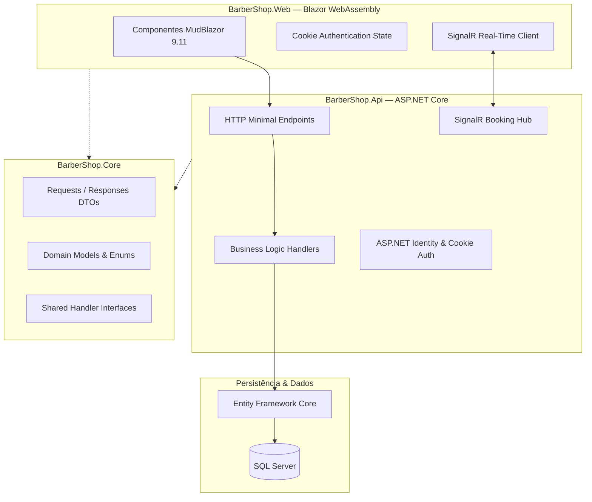

# 💈 BarberShop — Plataforma SaaS de Gestão e Agendamento em Tempo Real

> Solução completa e moderna para barbearias: agendamentos inteligentes sem conflitos de horários, notificações em tempo real com SignalR, controle financeiro, clube de assinaturas e suporte a PWA (Progressive Web App).

---

## 🌐 Demonstração Online

A aplicação está hospedada e ativa no Microsoft Azure:

- **🚀 Acessar Sistema**: [https://barbershop-web-gwbhheaaf0cfewgm.centralus-01.azurewebsites.net](https://barbershop-web-gwbhheaaf0cfewgm.centralus-01.azurewebsites.net)

---

## 💡 Sobre o Projeto

O **BarberShop** nasceu para solucionar os desafios operacionais do dia a dia de barbearias: agendamentos concorrentes, horários ociosos, falta de previsibilidade financeira e processos manuais.

Projetado como uma arquitetura desacoplada e escalável, o sistema atende tanto o cliente final (que agenda serviços em segundos pelo celular) quanto a equipe da barbearia e seus administradores (que contam com métricas financeiras, controle de profissionais e gestão de assinaturas).

---

## ✨ Principais Funcionalidades

### 📱 Experiência do Cliente (Mobile-First)
- **Agendamento Inteligente**: Cálculo automático de duração de serviços compostos e validação em tempo real para impedir agendamentos no mesmo horário/barbeiro.
- **Clube de Assinaturas (Planos)**: Visualização e contratação de planos de cortes com pagamentos recorrentes.
- **Pagamentos Integrados via Pix**: Geração de QR Code e código copia e cola para confirmação ágil.
- **Avaliações Verificadas**: Envio de notas e feedbacks com atualização dinâmica das médias do profissional.
- **PWA (Progressive Web App)**: Instalável diretamente na tela inicial de smartphones Android e iOS.

### 💼 Painel do Barbeiro & Administrativo
- **Agenda em Tempo Real**: Atualização instantânea dos horários via SignalR sempre que um novo agendamento é efetuado ou cancelado.
- **Dashboard Gerencial**: Gráficos e métricas de faturamento diário, semanal e mensal, taxa de ocupação e serviços mais procurados.
- **Gestão de Equipe & Filiais**: Cadastro de barbeiros, dias de funcionamento, bloqueio de feriados/folgas e tabelas de cortes.
- **Disparo de Avisos & Notificações**: Sistema de comunicados para clientes e equipe.

---

## 🏗️ Arquitetura e Decisões de Engenharia

O projeto adota uma arquitetura em camadas limpa, priorizando performance, manutenibilidade e baixo acoplamento:

### Destaques Técnicos:
- **Clean Architecture & Separação de Responsabilidades**: `BarberShop.Core` funciona como biblioteca pura compartilhada (zero dependências pesadas de infraestrutura).
- **Minimal APIs no ASP.NET Core**: Rotas leves mapeadas através da interface `IEndpoint`, reduzindo sobrecarga de overhead e maximizando throughput.
- **EF Core Otimizado**: Consultas com `AsNoTracking` em fluxos de leitura, índices estratégicos e projeções diretas em DTOs para evitar o problema de N+1.
- **Comunicação em Tempo Real com SignalR**: Hubs dedicados para atualização instantânea da grade de horários entre múltiplos clientes e barbeiros.
- **Frontend SPA Reativo com Blazor WASM**: Separação estrita de layout (`.razor`) e lógica de apresentação em code-behind (`.razor.cs`), com temas dinâmicos (Light & Dark Mode) e componentes MudBlazor.
- **Alta Cobertura de Testes Automatizados**: Suíte com mais de 240 testes unitários cobrindo regras críticas de conflito de horários, autorização e cálculos financeiros.

---

## 🛠️ Stack Tecnológica

| Camada | Tecnologias Utilizadas |
| :--- | :--- |
| **Linguagem & Plataforma** | C# 13/14, .NET 10 |
| **Frontend Web** | Blazor WebAssembly, MudBlazor 9.11, PWA, CSS Variables |
| **Backend API** | ASP.NET Core (Minimal APIs), SignalR Core |
| **Persistência & Banco** | Entity Framework Core, SQL Server |
| **Autenticação & Segurança** | ASP.NET Identity, Cookie Authentication, BCrypt |
| **Testes de Software** | xUnit, FluentAssertions |
| **Hospedagem & Cloud** | Microsoft Azure App Service |

---

## 🔒 Código-Fonte e Propriedade Intelectual

> **Aviso de Código Fechado**:
> Este projeto é uma solução SaaS comercial proprietária. Por questões de segurança, conformidade e proteção de propriedade intelectual, o código-fonte completo e as regras de negócio privadas são mantidos em repositório restrito.
>
> Este repositório vitrine tem como objetivo documentar a arquitetura, as decisões técnicas de engenharia de software e apresentar o produto em pleno funcionamento.

---

## 👨‍💻 Autor & Contato

Desenvolvido por **Maycon Douglas**.

- **GitHub**: [@maycondgl](https://github.com/maycondgl)
- **LinkedIn**: [linkedin.com/in/maycon-douglas-leite](https://www.linkedin.com/in/maycon-douglas-leite)
- **E-mail**: [maycon.dsl@hotmail.com](mailto:maycon.dsl@hotmail.com)
